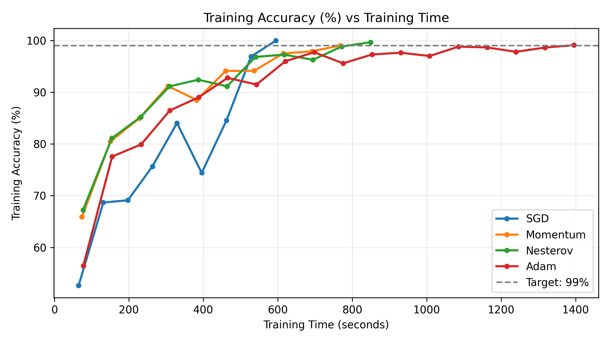
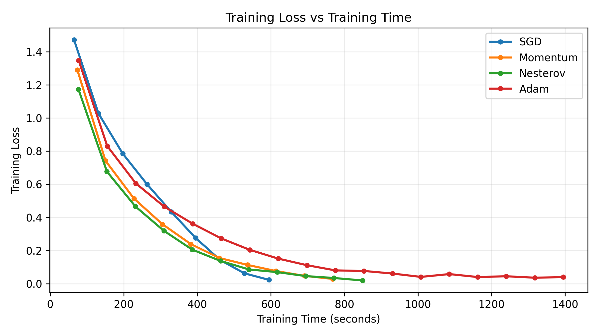

# Deep Learning Optimizer Benchmark

Comparison of SGD, Momentum, Nesterov Momentum, and Adam for training **ResNet-18 on CIFAR-10** using PyTorch.

## Objective

Measure how much GPU training time each optimizer needs to reach **99% training accuracy** under the settings used in the experiment.

## Experimental setup

- **Model:** ResNet-18
- **Dataset:** CIFAR-10
- **Framework:** PyTorch
- **GPU:** NVIDIA Tesla T4 (Google Colab)
- **Batch size:** 128
- **Loss:** Cross-entropy
- **SGD / Momentum / Nesterov learning rate:** 0.01
- **Momentum coefficient:** 0.9
- **Adam learning rate:** 0.001

The experiment uses PyTorch's built-in optimizers, rather than custom optimizer implementations.

## Results

| Optimizer | Time to 99% train accuracy | Relative speed vs SGD |
|---|---:|---:|
| **SGD** | **594.9 s** | **1.00×** |
| SGD + Momentum | 768.2 s | 0.77× |
| SGD + Nesterov | 849.5 s | 0.70× |
| Adam | 1395.2 s | 0.43× |

All four methods achieved the 99% *training* accuracy target. With these hyperparameters, standard SGD reached the target in the shortest time. This does not imply that SGD is generally better than Momentum, Nesterov, or Adam.

### Accuracy vs time

### Loss vs time

### Summary

## Discussion

The relative performance depends on the learning rate, optimizer configuration, model, and training setup. The comparison is based on one run per optimizer and a limited set of hyperparameters. It measures **training convergence**, not test accuracy or generalization.

## Repository contents

- `homework_resnet18_cifar10.ipynb` — training and evaluation notebook
- `results/results_all.json` — per-epoch experiment histories
- `figures/` — comparison charts
- `requirements.txt` — Python dependencies

## Running the notebook

Open `homework_resnet18_cifar10.ipynb` in Google Colab (GPU runtime) or in a local Jupyter environment with PyTorch. Download CIFAR-10 separately; the dataset is not included in this repository. **Update any local or Google Drive paths in the notebook** before running it. The saved JSON results and charts are provided so the reported comparison can be inspected without retraining.

## Possible extensions

- Evaluate test accuracy and generalization.
- Compare multiple learning rates and random seeds.
- Implement selected optimizers from scratch and verify them against PyTorch.
