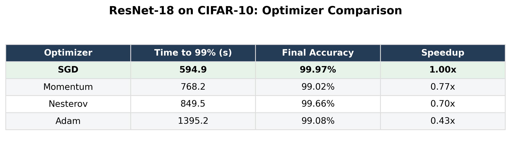

# Deep Learning Optimizer Benchmark

A comparison of four optimization methods for training **ResNet-18 on CIFAR-10** using PyTorch.

This project investigates how different optimizers affect training convergence and the time required to reach **99% training accuracy**.

The following optimizers are evaluated:
- Stochastic Gradient Descent (SGD)
- SGD with Momentum
- SGD with Nesterov Momentum
- Adam

## 1. Experimental Setup

Experiments were conducted using PyTorch with GPU acceleration on Google Colab.

| Parameter | Configuration |
|-----------|---------------|
| Dataset | CIFAR-10 |
| Architecture | ResNet-18 |
| Framework | PyTorch |
| GPU | NVIDIA Tesla T4 |
| Batch Size | 128 |
| Loss Function | Cross-Entropy Loss |
| Target Accuracy | 99% (Training) |

### Optimizer Configuration

| Optimizer | Learning Rate | Momentum |
|-----------|---------------|----------|
| SGD | 0.01 | - |
| SGD + Momentum | 0.01 | 0.9 |
| SGD + Nesterov | 0.01 | 0.9 |
| Adam | 0.001 | - |

All experiments use PyTorch's built-in optimizers.

The main evaluation metric is the elapsed training time
required to reach the target accuracy.

## 2. Experimental Results

All four optimizers successfully reached 99% training accuracy.

| Optimizer | Time to 99% (s) | Relative Speed vs SGD |
|-----------|-----------------|-----------------------|
| **SGD** | **594.9** | **1.00x** |
| SGD + Momentum | 768.2 | 0.77x |
| SGD + Nesterov | 849.5 | 0.70x |
| Adam | 1395.2 | 0.43x |

Under the selected hyperparameters, standard SGD reached
the target accuracy in the shortest time.

### Training Accuracy


The figure compares training accuracy as a function of
elapsed training time.

### Training Loss


All four optimizers successfully reduced the training loss,
although their convergence behavior differed.

### Optimizer Comparison



## 3. Discussion

Standard SGD achieved the best time-to-target performance
in this experiment.

Momentum and Nesterov did not outperform standard SGD
under the selected training configuration.

Adam also converged successfully, but required more time
to reach the target accuracy.

These results do not imply that SGD is generally superior.
Optimizer performance depends on several factors, including:

- Learning rate selection
- Momentum and other optimizer parameters
- Neural network architecture
- Dataset and training configuration

The experiments were conducted with one training run per
optimizer and a limited set of hyperparameters.

Additionally, the comparison focuses on training accuracy
rather than test accuracy. Therefore, the results should
not be interpreted as a comparison of generalization performance.

## 4. Repository Structure

```text
deep-learning-optimizer-benchmark/
|
|-- README.md
|-- requirements.txt
|-- resnet18_optimizer_benchmark.ipynb
|
|-- figures/
|   |-- accuracy_vs_time.png
|   |-- loss_vs_time.png
|   |-- optimizer_comparison.png
|
|-- results/
|   |-- results_all.json
|
|-- scripts/
|-- setup/
```

The repository also contains PDF versions of the figures.

## 5. Reproducing the Experiments

The experiments were originally conducted in Google Colab
using an NVIDIA Tesla T4 GPU.

1. Open `resnet18_optimizer_benchmark.ipynb` in Google Colab.
2. Enable GPU acceleration.
3. Install the required Python packages if necessary.
4. Download the CIFAR-10 dataset.
5. Update the dataset and Google Drive paths in the notebook.
6. Run the training experiments.

The saved training histories are available in:

`results/results_all.json`

These results can be used to reproduce the plots without
retraining all four models.

**Note:** The notebook contains some Google Colab-specific
paths that may need adjustment for other environments.

## 6. Future Improvements

Possible extensions include:

- Implementing optimization algorithms from scratch
- Comparing different learning rate schedules
- Evaluating optimizer sensitivity to hyperparameters
- Testing generalization performance
- Studying convergence on strongly convex quadratic functions

## 7. Tools

Python, PyTorch, NumPy, Matplotlib, Pandas, Google Colab.

---

**Project focus:** Numerical Optimization, Deep Learning,
Optimizer Benchmarking.